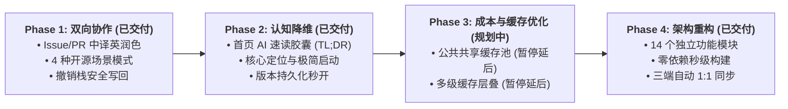
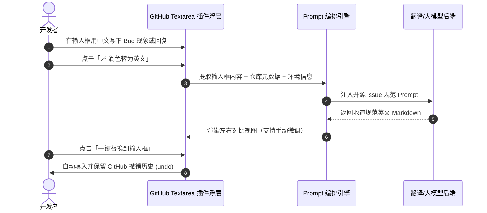
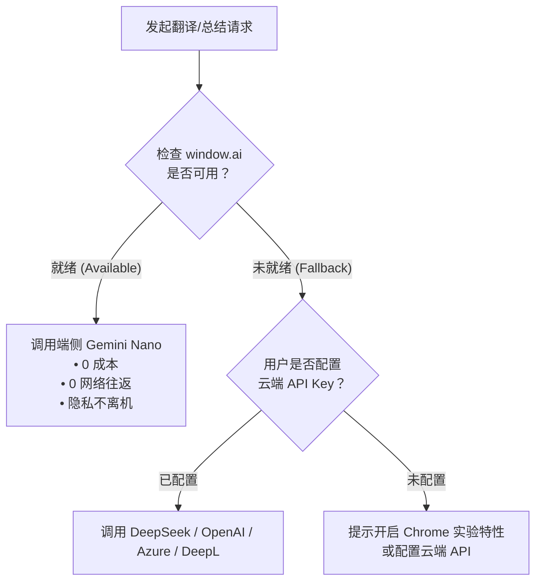

# GitHub 中文插件 v3.0 演进开发计划：从“汉化脚本”迈向“开源协作套件”

> **版本**：v3.0.0 阶段开发纲要  
> **状态**：待评审 (Draft)  
> **核心宗旨**：基于第一性原理，消除中国开发者在 GitHub 上的认知负荷与语言协作障碍。

---

## 目录
- [一、战略定位与核心目标](#一战略定位与核心目标)
- [二、总体演进路线图 (Milestones)](#二总体演进路线图-milestones)
- [三、核心功能规格与任务拆解](#三核心功能规格与任务拆解)
  - [Phase 1: 开源协作双向赋能（Issue / PR 撰写助手）](#phase-1-开源协作双向赋能issue--pr-撰写助手)
  - [Phase 2: 认知降维与代码阅读（速读胶囊 + 源码注释翻译）](#phase-2-认知降维与代码阅读速读胶囊--源码注释翻译)
  - [Phase 3: 零成本与隐私优先（共享缓存规划）](#phase-3-零成本与隐私优先共享缓存规划)
- [四、工程架构改造与跨端适配](#四工程架构改造与跨端适配)
- [五、风险评估与应对策略](#五风险评估与应对策略)

---

## 一、战略定位与核心目标

### 1.1 核心价值升级
- **现状（v1.x ~ v2.x）**：单向只读的页面本地汉化 + README/Issue 正文 AI 机翻。
- **演进（v3.0+）**：
  1. **协作闭环**：不仅能“读懂”，更要能“地道输出”（提 Issue、写 PR、回评论）。
  2. **信息降维**：不仅是“全文机翻”，而是提炼关键信息（TL;DR 速读胶囊）。
  3. **源码理解**：突破非代码页面限制，切入文件代码阅读区（只翻注释，不破坏代码）。
  4. **成本优化**：通过本地缓存和公共哈希共享缓存规划，减少重复翻译请求与用户 Token 支出。

### 1.2 核心量化指标 (KPIs)
| 指标项 | 现状 | v3.0 目标 |
| :--- | :--- | :--- |
| **功能覆盖面** | 仅阅读浏览（100% 只读） | 涵盖“阅读、速读、源码理解、协作提交”四维闭环 |
| **首屏感知延迟** | 首次访问需 4~10s 机翻等待 | 胶囊速读 < 1.5s，热门项目共享缓存秒开（< 50ms） |
| **Token 消耗成本** | 每个用户对同一 README 重复付费 | 热门仓库共享缓存命中率 > 60%，支持端侧 0 成本模型 |
| **代码阅读保真度** | 全文机翻会导致代码错乱或被破坏 | 源码 AST/正则提取注释，代码本身 0 污染、100% 保真 |

---

## 二、总体演进路线图 (Milestones)



---

## 三、核心功能规格与任务拆解

### Phase 1: 开源协作双向赋能（Issue / PR 撰写助手）

> [!IMPORTANT]
> **解决痛点**：中国开发者提 Issue 容易因中式英文、表述不清或模板残缺而被海外维护者打上 `need-english` / `invalid` 标签甚至直接关闭。

#### 1. 核心功能规格
1. **输入框增强工具条**：
   - 在 GitHub Issue 新建、PR 新建、讨论回复的 Textarea 右下角注入「🪄 润色转为英文」悬浮按钮。
   - 点击后弹出侧拉面板或模态对照浮层，支持中文草稿输入，右侧实时显示生成的**标准开源规范英文**。
2. **结构化模板注入**：
   - 根据仓库既有的 Issue 模板，将用户的口语化描述自动归入：
     - `### Description`（问题简述）
     - `### Steps to Reproduce`（复现步骤）
     - `### Expected vs Actual`（预期与实际表现）
     - `### Environment`（自动捕获当前 OS/Browser 环境）
3. **开源礼仪与语气润色 (OSS Etiquette)**：
   - 提供「严谨客观 (Bug Report)」、「建设性探讨 (Feature Request)」、「礼貌致谢 (Follow-up)」三种语气预设。



#### 2. 开发任务清单
- [x] **Task 1.1**: GitHub 评论与讨论区 Markdown Textarea 挂载机制（兼容 React 动态表单、新旧版本 Markdown Editor、TabNav 及内联代码评审）。 *(已完成)*
- [x] **Task 1.2**: 双向对比弹窗/浮层 UI 组件开发（支持 Markdown 预览与实时编辑、暗色/亮色模式自适应）。 *(已完成)*
- [x] **Task 1.3**: 开源协作专属 Prompt 工程设计（4 种模式：Bug 反馈、功能建议、讨论回复、通用润色；严格纯 Markdown 输出）。 *(已完成)*
- [x] **Task 1.4**: 浏览器撤销栈保护（通过 `document.execCommand('insertText')` 确保 `Ctrl+Z` / `Cmd+Z` 可回退，并配合原型 setter 触发 React 事件分发）。 *(已完成)*
- [x] **Task 1.5**: 单元测试与多端一致性验证（Chrome/Edge/Firefox 三端代码一致性，39 项测试 100% 通过）。 *(已完成)*

> **阶段交付状态**：✅ **Phase 1 已全量交付上线**（2026-10-21）。可在设置页开启「协作润色助手」体验。

---

### Phase 2: 认知降维（项目首页 AI 速读胶囊 TL;DR Capsule）

> [!NOTE]
> **设计取向**：开发者浏览海量开源项目时，最迫切的需求是在 3 秒内判断“这个项目是做什么的、如何启动、适不适合我的业务场景”，无需陷入漫长 README 的通读。

#### 1. 核心功能规格
- **挂载位置**：位于仓库首页 README 区域顶部，以清爽的 Card 呈现。
- **输出规格（限制 150 Token 以内，结构化极速输出）**：
  - **🎯 核心定位**：一句话直击痛点，说明这个项目解决什么具体问题。
  - **⚡ 3秒极简启动**：提取最具代表性的一行命令（curl / npm / pip / docker 等）。
  - **💡 选型考量**：说明同类对比或适用场景（如：“相比 XX 更轻量，适合小型集群”）。
- **缓存策略**：以 `repo:sourceHash` 为 Hash 键，本地持久化缓存，同一版本无需重复生成。
- **状态控制**：未生成时显示轻量生成条，支持一键生成；生成后支持折叠/展开与重新生成。

#### 2. 开发任务清单
- [x] **Task 2.1**: TL;DR 胶囊 UI 设计与 DOM 智能挂载（兼容新旧 README 容器，支持折叠/展开与优雅过渡）。 *(已完成)*
- [x] **Task 2.2**: 胶囊摘要 Prompt 调优与极低 Token 结构化控制（三要素输出：核心定位、3秒极简启动、选型考量，一键命令复制）。 *(已完成)*
- [x] **Task 2.3**: 胶囊本地持久化缓存与状态流转（`repo:sourceHash` 缓存秒开、重新生成刷新、记录 Token 消耗）。 *(已完成)*
- [x] **Task 2.4**: 选项页开关与权限校验（`enable_repo_tldr`，三浏览器同步，40 项自动化测试全量通过）。 *(已完成)*

> **阶段交付状态**：✅ **Phase 2 已全量交付上线**（2026-10-21）。可在设置页开启「仓库首页 AI 速读胶囊 (TL;DR)」体验。

---

### Phase 3: 零成本与隐私优先（共享缓存规划）

#### 1. Chrome 原生 AI（暂未实现）
- **背景**：现代浏览器逐步标准化端侧大模型 API：
  - `window.ai.translator`（文本翻译）
  - `window.ai.summarizer`（文本总结）
  - `window.ai.languageDetector`（语言检测）
- **收益**：
  - **0 门槛**：用户不需要注册任何第三方平台，无需填写 API Key。
  - **0 资费**：无限额度，纯本地 NPU/GPU 运算。
  - **100% 隐私安全**：私有企业仓库代码和敏感 Issue 绝不出内网设备。
- **架构方案**：
  - 在翻译提供商（Provider）中将 `Built-in AI (Gemini Nano)` 设为推荐选项。
  - 自动嗅探设备是否支持，若支持则默认优先启用；未就绪时自动平滑回退至云端 DeepSeek / OpenAI。



#### 2. 热门开源仓库 README 公共哈希缓存池 (Shared Cache)
- **痛点**：全中国数万开发者浏览 `facebook/react` 某个 Commit 的 README 时，各自调用了数万次 API 重复机翻。
- **设计**：
  - 采用 **Content-Addressed (基于内容哈希)** 的去中心化/只读公共缓存：
    - Key: `repo_full_name + source_content_hash + target_lang`
  - 缓存数据托管在免费高可用的只读 CDN（如 Cloudflare R2 / Workers KV 或 GitHub 静态存储）。
  - 用户插件先以 `HEAD / GET` 检查公共缓存，命中则直接秒拉（耗时 < 50ms，耗费 0 Token）；未命中才由首位浏览者调用本地/云端生成。

#### 3. 开发任务清单
- [ ] **Task 3.1**: `window.ai`（Translator & Summarizer & Prompt API）端侧模型适配层封装与生命周期管理。 *(未实现，当前版本不包含端侧 AI)*
- [ ] **Task 3.2**: 选项页增加「Chrome 原生端侧 AI」状态探测指示器与降级引导。 *(未实现)*
- [ ] **Task 3.3**: 公共共享缓存池接口协议设计（防投毒签名校验、只读匿名拉取）。 *(⏸️ 暂停开发 / 延后)*
- [ ] **Task 3.4**: 离线/在线多级缓存层叠调度引擎（Memory LRU ➔ Local Storage ➔ Remote CDN ➔ AI Provider）。 *(⏸️ 暂停开发 / 延后)*

> **阶段交付状态**：
> - ⏸️ **Task 3.1 & 3.2 端侧 AI**：当前源码未包含 `builtin-ai.js` 或 `window.ai` 适配层，暂不对外宣称已交付。
> - ⏸️ **Task 3.3 & 3.4 公共共享缓存池与多级调度引擎**：已标记为**暂停开发、延后推进**，优先保障本地端侧 AI 零成本体验与核心架构稳定性。

---

## 四、工程架构改造与跨端适配

为了承载上述功能并保证代码库的可维护性，已将原 5,590 行单体 `content.js` 彻底重构演进为模块化架构，并配备了零外部依赖的极速构建同步流水线：

```text
chrome/
├── src/
│   ├── core/
│   │   ├── constants.js            # 全局配置、默认状态、Prompts 模板
│   │   ├── utils.js                # 实体转义、哈希计算、URL 处理
│   │   ├── storage-cache.js        # 多级缓存、仓库抽取、Token 统计
│   │   ├── text-filter.js          # 技术术语保护、跳过规则、CJK 过滤
│   │   └── dom-observer.js         # DOM 监听、Turbo 守卫、DOM 遍历
│   ├── providers/
│   │   ├── provider-config.js      # Provider 配置解析与签名
│   │   ├── cloud-translators.js    # DeepSeek / OpenAI / DeepL / Azure / Qwen 协议
│   │   └── dispatcher.js           # 并发批处理调度器与错误降级
│   ├── features/
│   │   ├── ui-localization.js      # locals.js 静态词库匹配、时间格式化、全局顶栏
│   │   ├── markdown-translation.js # README / About 翻译、渐进式渲染
│   │   ├── discussion-translation.js# Issue / PR 讨论区双向翻译与对照
│   │   ├── collaboration-helper.js # Issue / PR 英文协作润色助手
│   │   └── tldr-capsule.js         # 仓库首页 AI 速读胶囊
│   └── entry.js                    # 插件生命周期入口与启动挂载
├── content.js                      # 自动构建产物（供扩展安全加载）
├── locals.js                       # 静态词库
└── manifest.json
```

- **构建与校验工具**：
  - `npm run build` (`node script/build.js`)：一键编译 14 个模块并自动 1:1 同步至 `chrome/`、`edge/`、`firefox/`。
  - `npm test`：包含 `--check` 自动守卫，防止直接修改产物导致源码不同步，并运行 Issue/PR 功能测试、上游回归测试及辅助脚本检查。
- **架构改造交付状态**：✅ **模块化架构已全量完成交付上线**（2026-10-21）。

---

## 五、风险评估与应对策略

| 风险点 | 影响程度 | 应对策略 |
| :--- | :---: | :--- |
| **GitHub DOM 结构频繁变动** | 高 | 坚持使用基于无障碍语义（`aria-*`, `data-testid`, 语义标签）而非动态 CSS-Module 哈希类名进行挂载；注入前做多重空安全保护。 |
| **开源润色可能产生模型幻觉** | 中 | 采用双栏严格对照 UI，替换前必须由用户确认或手动微调，绝不静默自动提交表单。 |
| **未来 Chrome 原生 `window.ai` 碎片化** | 中 | 在功能真正实现前保持云端 Provider 路径；后续接入时再封装 Feature Detection，并保证 Edge/Firefox 可降级。 |
| **扩展体积膨胀** | 低 | 静态词库维持当前 ~2MB 离线结构；所有新型智能特性依赖模型 Prompt 驱动与端侧运行时，不额外引入沉重前端第三方框架。 |

---

> [!NOTE]
> 本计划书已生成为持久化规划文档。如需针对某个具体阶段（例如优先启动 **Phase 1 的 Issue/PR 中译英协作助手**）进行具体交互原型设计与接口编码，可随时开启对应任务。
